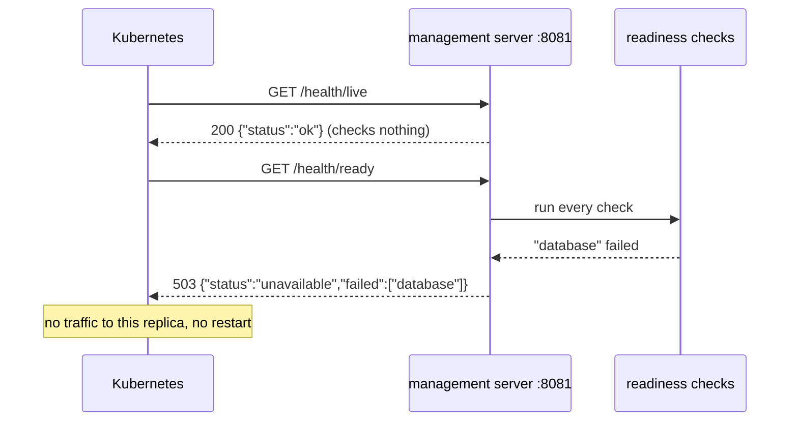

# Health endpoints

The **health endpoints** are three HTTP endpoints on the management port (`8081`). Two of them always answer "ok" while the process answers at all; they still differ, because **different callers act on them differently**, and what each may grow into differs.

## Why there are three

| Endpoint | Asked by | The question | What the caller does on a failure |
|---|---|---|---|
| `GET /health/live` | Kubernetes `livenessProbe`, Docker `healthcheck` | is the process alive, or hung? | **kills and restarts** the container |
| `GET /health/ready` | Kubernetes `readinessProbe` | can it serve a request now — are its dependencies there? | **stops sending traffic** to it, without restarting it |
| `GET /health` | a person, a dashboard, a client | which version is running, and is it up? | nothing automatic — it is never probed |

Today `/health/live` and `/health` differ only in the version in the body. The difference that matters is the contract:

- `/health/live` must stay **trivial forever**. Whatever it checks can restart the service: if it checked the database, a database outage would restart every replica in a loop, and none would come back faster. So it checks nothing and never will.
- `/health` is **free to grow** — the build, the uptime, the state of each dependency for a person to read — because no orchestrator acts on its answer. Putting that into `/health/live` would turn information into restarts.
- `/health/ready` is where dependencies count: while one is down, the replica is taken out of the load balancer and put back when it recovers, with no restart.

## How it works



| Endpoint | 200 body | Otherwise |
|---|---|---|
| `/health/live` | `{"status":"ok"}` | no answer at all — the process is hung or gone |
| `/health/ready` | `{"status":"ok"}` | 503 `{"status":"unavailable","failed":["database"]}` |
| `/health` | `{"status":"ok","version":"1.4.0"}` | no answer at all |

## Example

```yaml
# Kubernetes: two probes, two endpoints, one port
livenessProbe:
  httpGet: {path: /health/live, port: 8081}
readinessProbe:
  httpGet: {path: /health/ready, port: 8081}
```

## Related concepts

- [Readiness check](./readiness-check.md) — what makes `/health/ready` fail.
- `devops-service-deploy` — the probes and `healthcheck`s that call these endpoints.

## Sources

- Kubernetes, liveness, readiness and startup probes: https://kubernetes.io/docs/concepts/configuration/liveness-readiness-startup-probes/
- Kubernetes, configure the probes: https://kubernetes.io/docs/tasks/configure-pod-container/configure-liveness-readiness-startup-probes/
