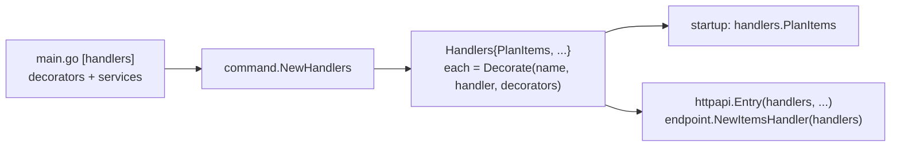

# Command registry

The **command registry** (`internal/command/handlers.go`) is the one place that builds the handler of every command and wraps each with the [decorators](./handler-decorator.md): the struct `command.Handlers`, one field per command, filled by `command.NewHandlers`.

## Why it exists

Without it the [composition root](./composition-root.md) built and wrapped each handler itself, one line per command and decorator. A decorator that every command needs — logging, an access check — then had to be added once per command, and a command added in a hurry could miss one. The registry turns "every handler" into one call: the composition root gives the list of decorators once, and a new command touches only the command layer.

## How it works

1. The composition root calls `command.NewHandlers(decorators, services...)` once, in `// [handlers]`.
2. `NewHandlers` builds each handler with the services it uses and wraps it with `pipeline.Decorate(name, handler, decorators)`.
3. Each field holds a typed `pipeline.Handler[TCommand, TResult]` — already decorated, so an entry point cannot tell it from a plain one.
4. An entry point takes the handlers it serves: the startup entry `handlers.PlanItems`, an API's resource its own commands in `New{Resource}Handler(handlers)`.



## How it is structured

| Part | Rule |
|---|---|
| `Handlers` | one typed field per command, named like the command without `Command` |
| `NewHandlers(decorators []pipeline.Decorator, services...)` | the decorators first, then the services the handlers use, each typed by an interface of `internal/command` |
| a new command | a field and a line here, its file in `internal/command`; `main.go` does not change |
| a new service | a parameter here, passed by `main.go` from `// [services]` |

## Example

```go
// internal/command/handlers.go
type Handlers struct {
	PlanItems pipeline.Handler[PlanItemsCommand, PlanItemsResult]
}

func NewHandlers(decorators []pipeline.Decorator) Handlers {
	return Handlers{
		PlanItems: pipeline.Decorate("PlanItems", NewPlanItemsHandler(), decorators),
	}
}
```

## Related concepts

- [Handler decorator](./handler-decorator.md)
- [Composition root](./composition-root.md)
- [Handler contract](./handler-contract.md)

## Sources

- [handlers.go](../examples/internal/command/handlers.go)
