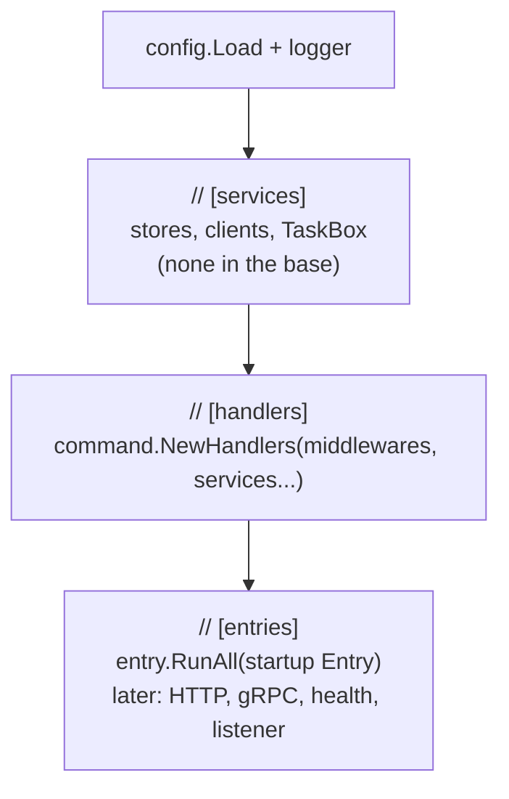

# Composition root

The **composition root** is the one place in the program that creates every concrete object and connects them: in Go, the `run` function in `cmd/{app}/main.go`. Every other package receives what it needs as parameters and never creates its collaborators itself.

## Why it exists

If a handler created its own store, or an entry point created its own handler, a variation point that wants to replace or wrap that object would have to edit the package that creates it. Collecting all construction in one function makes that function the only file a variation point edits — the base plateau's promise.

Go has no dependency-injection container by default; the composition root is plain code that calls constructors in order. That is the Go equivalent of `Program.cs` with `services.AddX()` in dotnet.

## How it works

`run` builds the program in three marked sections, always in this order:



1. **services** — infrastructure objects (a DB variation point adds its repository here).
2. **handlers** — one call of the [command registry](./command-registry.md), given the list of [command middleware](./command-middleware.md) and the services; it builds and wraps the handler of every command.
3. **entries** — the entry points that call the handlers, one `Entry` each, run together by the [entry runner](./entry-runner.md).

`main` only creates a context that is cancelled on `SIGINT`/`SIGTERM` and calls `run(ctx, os.Stdout, os.Stderr)`, so a long-running entry point stops gracefully and `run` can be called with any output streams.

## How it is structured

| Section comment | Who adds lines there |
|---|---|
| `// [services]` | service variation points: DB, HTTP/gRPC client, producer, TaskBox |
| `// [handlers]` | middleware variation points, one element of the list each; a service variation point passes its service to `command.NewHandlers` (a new command changes only `internal/command`) |
| `// [entries]` | API variation points (HTTP, gRPC, CLI, listener) replace the startup `Entry` with the one their entry factory builds; the health variation point adds its own; an API middleware variation point adds to an API's list of middlewares |

## Example

```go
// [handlers] - the handler of every command, built by the command registry
// and wrapped by this command middleware, the first the outermost.
handlers := command.NewHandlers([]pipeline.Middleware{
	commandlogging.Middleware(logger),
})

// [entries] - every entry point, one Entry each; the base plateau has only the startup command.
err = entry.RunAll(ctx, logger,
	entry.Entry{Name: "startup", Run: func(ctx context.Context) error {
		return startup.Run(ctx, handlers.PlanItems, command.PlanItemsCommand{Titles: startup.EnvList("STARTUP_TITLES")}, stdout)
	}},
)
return entry.ExitCode(err)
```

## Related concepts

- [Command middleware](./command-middleware.md)
- [Command registry](./command-registry.md)
- [Startup entry](./startup-entry.md)
- [Entry runner](./entry-runner.md)

## Sources

- Mark Seemann, "Composition Root": https://blog.ploeh.dk/2011/07/28/CompositionRoot/
- [main.go](../examples/cmd/todo/main.go)
