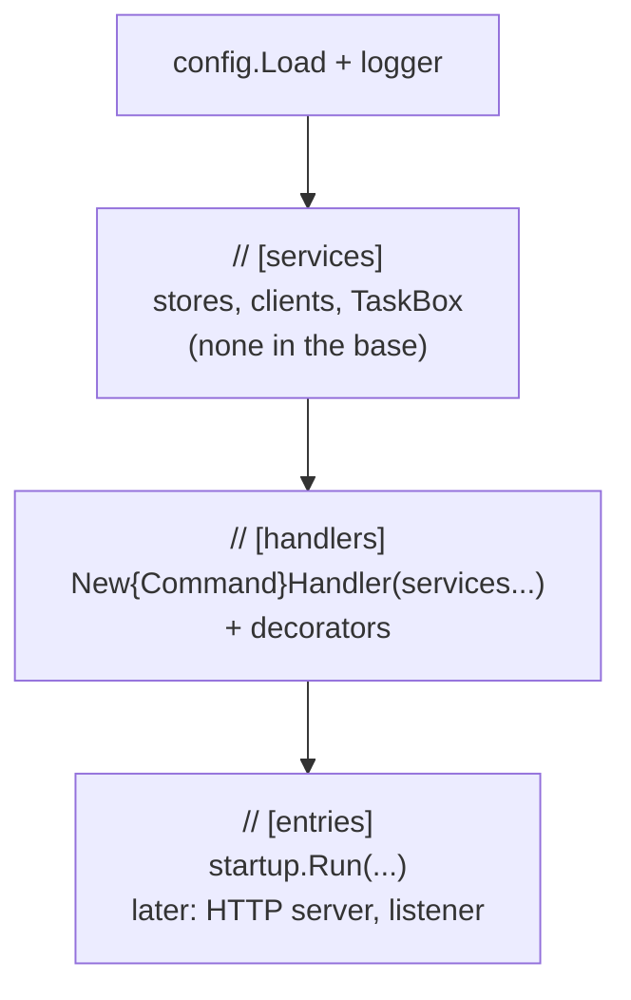

# Composition root

The **composition root** is the one place in the program that creates every concrete object and connects them: in Go, the `run` function in `cmd/{app}/main.go`. Every other package receives what it needs as parameters and never creates its collaborators itself.

## Why it exists

If a handler created its own store, or an entry point created its own handler, a variation point that wants to replace or wrap that object would have to edit the package that creates it. Collecting all construction in one function makes that function the only file a variation point edits — the base plateau's promise.

Go has no dependency-injection container by default; the composition root is plain code that calls constructors in order. That is the Go equivalent of `Program.cs` with `services.AddX()` in dotnet.

## How it works

`run` builds the program in three marked sections, always in this order:



1. **services** — infrastructure objects (a DB variation point adds its repository here).
2. **handlers** — one per command, receiving the services through its constructor, then wrapped by [decorators](./handler-decorator.md).
3. **entries** — the entry points that call the handlers.

`main` only calls `os.Exit(run(context.Background(), os.Stdout, os.Stderr))`, so `run` can be called with any output streams.

## How it is structured

| Section comment | Who adds lines there |
|---|---|
| `// [services]` | service variation points: DB, HTTP/gRPC client, producer, TaskBox |
| `// [handlers]` | every new command; decorator variation points |
| `// [entries]` | API variation points: HTTP, gRPC, CLI, listener |

## Example

```go
// [handlers] - one per command, wrapped by its decorators.
var planItems command.Handler[command.PlanItems, command.PlanItemsResult] = command.NewPlanItemsHandler()
planItems = command.WithLogging("PlanItems", logger, planItems)

// [entries] - every entry point; the base plateau has only the startup command.
err = startup.Run(ctx, planItems, command.PlanItems{Titles: cfg.StartupTitles}, stdout)
```

## Related concepts

- [Handler decorator](./handler-decorator.md)
- [Startup entry](./startup-entry.md)

## Sources

- Mark Seemann, "Composition Root": https://blog.ploeh.dk/2011/07/28/CompositionRoot/
- [main.go](../examples/cmd/todo/main.go)
