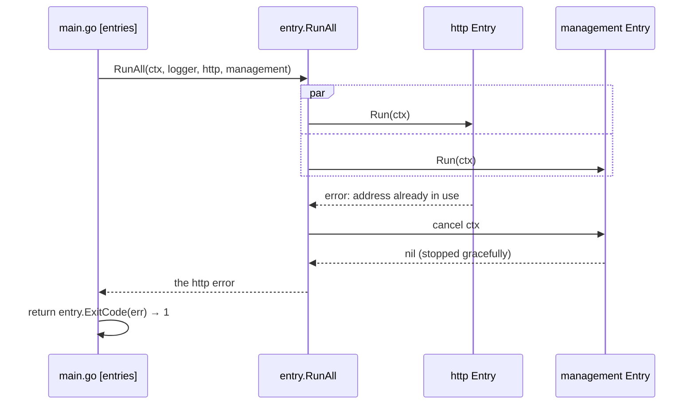

# Entry runner

The **entry runner** (`internal/api/entry`) starts every entry point of the application together — the startup command, an HTTP server, a gRPC server, the health endpoints — and turns how they ended into the process exit code. It is why each variation point attaches with one line in `// [entries]`.

## Why it exists

`httpapi.Run(ctx, ...)` blocks until the process is told to stop. Written one after another, the second entry point would never start:

```go
httpapi.Run(ctx, routes, logger)   // blocks here until SIGTERM
management.Run(ctx, logger)        // never reached
```

Starting both needs goroutines, and stopping the others when one fails. Written by each variation point, every pair of variation points (HTTP + health, gRPC + health, HTTP + gRPC) would become its own piece of code. Written once in the base, each variation point only adds an item to a list.

## How it works

1. `[entries]` passes `RunAll` one `Entry{Name, Run}` per entry point.
2. `RunAll` starts every `Run` at once, each with the same context.
3. When the **first** one returns — a one-shot command done, a server that failed, or every server after SIGTERM — `RunAll` cancels the context, so the others stop gracefully, and waits for them.
4. It returns the first error any entry returned, or `nil`.
5. `ExitCode(err)` turns it into the exit code by the [error kind](./error-kind.md).



| Situation | Result | Exit code |
|---|---|:-:|
| startup command done | the others are stopped | `0` |
| SIGTERM | every entry stops gracefully | `0` |
| a server cannot start (port taken) | the others are stopped | `1` |
| startup command rejected (a kind other than unavailable) | the others are stopped | `2` |

## How it is structured

| Part | Role |
|---|---|
| `Entry{Name, Run, ReportsErrors}` | one entry point: its name for the logs, the function that serves until ctx is cancelled, and whether it shows its own error (the CLI prints `Error: ...`), so `RunAll` does not log it again |
| `RunAll(ctx, logger, entries...)` | runs all together, stops all when the first ends, logs each failure with its name |
| `ExitCode(err)` | error kind → `ExitOK` (0), `ExitFailure` (1), `ExitRejected` (2) |

## Example

```go
// [entries] - a service with HTTP and health: each variation point brought one Entry.
err = entry.RunAll(ctx, logger,
	entry.Entry{Name: "http", Run: func(ctx context.Context) error {
		return httpapi.Run(ctx, routes, logger)
	}},
	entry.Entry{Name: "management", Run: func(ctx context.Context) error {
		return management.Run(ctx, logger)
	}},
)
return entry.ExitCode(err)
```

## Related concepts

- [Composition root](./composition-root.md) — where the list is written.
- [Startup entry](./startup-entry.md) — the base plateau's one entry, replaced by an API variation point.

## Sources

- `context.WithCancel`: https://pkg.go.dev/context#WithCancel
- Go blog, pipelines and cancellation: https://go.dev/blog/pipelines
