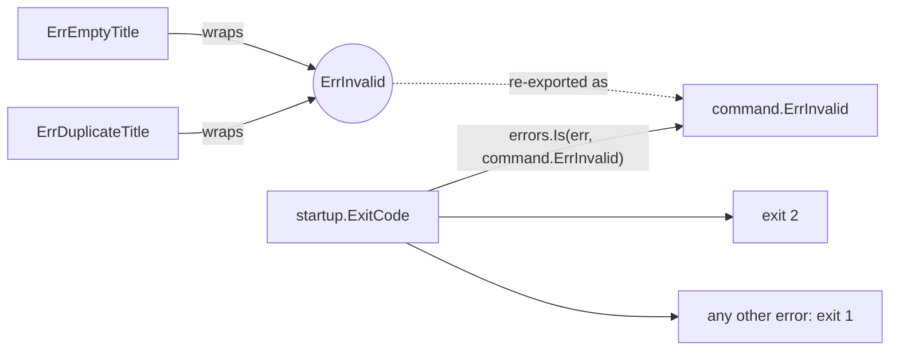

# Error kind

An **error kind** is one sentinel error that a whole family of errors wraps, so a caller asks "is this a *kind* of error?" instead of "is this *exactly* that error?". The base plateau has one kind: `ErrInvalid` — the command broke a business rule.

## Why it exists

An entry point has to answer differently to "your input is wrong" and "something broke": exit code `2` vs `1` for the startup command, later HTTP `400` vs `500`. But an entry point must not import the domain, and must not list every rule error (`ErrEmptyTitle`, `ErrDuplicateTitle`, ...) — that list would change with every new rule.

With one kind, every rule error carries the same marker, and the entry point checks only the marker.

## How it works

1. The entity package declares the sentinel: `var ErrInvalid = errors.New("invalid")`.
2. Each rule error wraps it with `%w`: `ErrEmptyTitle = fmt.Errorf("%w: item title is empty", ErrInvalid)`.
3. `errors.Is(err, ErrInvalid)` walks the wrap chain, so it is true for every rule error — and for a rule error wrapped again later.
4. The `command` package re-exports it — `command.ErrInvalid = entity.ErrInvalid` — so entry points use it without importing the domain.



## How it is structured

| Part | Where |
|---|---|
| `ErrInvalid` sentinel | `internal/domain/entity/errors.go` |
| one error per business rule, wrapping `ErrInvalid` | `internal/domain/entity/errors.go` |
| `command.ErrInvalid` re-export | `internal/command/handler.go` |
| mapping kind → response | each entry point (`startup.ExitCode`; later the HTTP status mapper) |

## Example

```go
// internal/api/startup/startup.go
case errors.Is(err, command.ErrInvalid):
    return ExitRejected // 2
```

## Related concepts

- [Startup entry](./startup-entry.md) — maps the kind to an exit code.
- [Handler contract](./handler-contract.md) — handlers return these errors.

## Sources

- `errors.Is`: https://pkg.go.dev/errors#Is
- Go blog, working with errors in Go 1.13 (wrapping with `%w`): https://go.dev/blog/go1.13-errors
