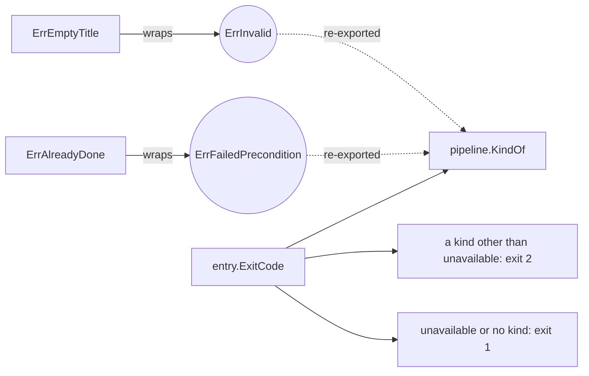

# Error kind

An **error kind** is one sentinel error that a whole family of errors wraps, so a caller asks "is this a *kind* of error?" instead of "is this *exactly* that error?". The application has the eleven kinds of [error-kinds](library/develop/core/error-kinds.skill/error-kinds.skill.md) — `ErrInvalid`, `ErrNotFound`, `ErrConflict`, … — and "no kind" for a failure of the service.

## Why it exists

An entry point has to answer differently to "your input is wrong", "this does not exist", and "something broke": exit code `2` vs `1` for the startup command, HTTP `400` / `404` / `500`, gRPC `INVALID_ARGUMENT` / `NOT_FOUND` / `INTERNAL`. But an entry point must not import the domain, and must not list every rule error (`ErrEmptyTitle`, `ErrDuplicateTitle`, ...) — that list would change with every new rule.

With kinds, every rule error carries one marker, and the entry point checks only the marker.

## How it works

1. `internal/domain/entity/kinds.go` declares one sentinel per kind: `var ErrInvalid = errors.New("invalid")`, `var ErrNotFound = errors.New("not found")`, ...
2. Each rule error wraps its kind with `%w`: `ErrEmptyTitle = fmt.Errorf("%w: item title is empty", ErrInvalid)`, `ErrAlreadyDone = fmt.Errorf("%w: item is already done", ErrFailedPrecondition)`.
3. `errors.Is(err, ErrInvalid)` walks the wrap chain, so it is true for every rule error of that kind — and for a rule error wrapped again later.
4. The `pipeline` package re-exports the kinds — `pipeline.ErrInvalid = entity.ErrInvalid`, ... — and offers `KindOf(err)`, so entry points use them without importing the domain.



## How it is structured

| Part | Where |
|---|---|
| one sentinel per kind | `internal/domain/entity/kinds.go` (template of `error-kinds-in-go`) |
| one error per business rule, wrapping its kind | `internal/domain/entity/errors.go` |
| the kinds re-exported, `Kinds`, `KindOf` | `internal/command/pipeline/errors.go` (template of `error-kinds-in-go`) |
| mapping kind → answer | the exit code: `entry.ExitCode`; HTTP and gRPC: `internal/api/core/rpcstatus` |

## Example

```go
// internal/api/core/entry/entry.go
switch kind := pipeline.KindOf(err); {
case err == nil:
    return ExitOK
case kind == nil, kind == pipeline.ErrUnavailable:
    return ExitFailure // 1: a retry may change the outcome
default:
    return ExitRejected // 2: the request was rejected
}
```

## Related concepts

- [Entry runner](./entry-runner.md) — maps the kind to an exit code.
- [Handler contract](./handler-contract.md) — handlers return these errors.

## Sources

- `errors.Is`: https://pkg.go.dev/errors#Is
- Go blog, working with errors in Go 1.13 (wrapping with `%w`): https://go.dev/blog/go1.13-errors
- Google API design guide, errors (the codes of the kinds): https://cloud.google.com/apis/design/errors
