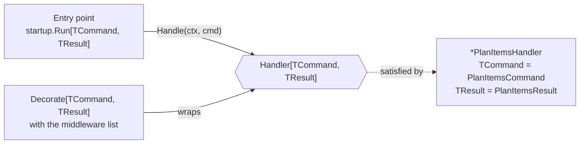

# Handler contract

The **handler contract** is the one Go interface every command handler of the application satisfies: `Handler[TCommand, TResult]` in `internal/command/pipeline/handler.go`. It says "give me a context and a command of type `TCommand`, I give you back a result of type `TResult` or an error".

## Why it exists

An application has many commands, each with its own input and output types. Without a shared shape, every piece of code that is *not* about one specific command — an entry point that serves commands (startup, HTTP, CLI), a middleware that logs or opens a transaction — would have to be written again for every command.

With one contract, that code is written once against `Handler[TCommand, TResult]` and works for any handler. This is what lets a variation point attach by adding a few lines instead of editing every handler.

## How it works

The contract uses Go **generics** (type parameters, Go 1.18+). `TCommand` and `TResult` are placeholders filled in by each concrete handler:

```go
type Handler[TCommand, TResult any] interface {
    Handle(ctx context.Context, cmd TCommand) (TResult, error)
}
```

- `any` means "any type is allowed" for that parameter.
- `PlanItemsHandler` has the method `Handle(ctx, PlanItemsCommand) (PlanItemsResult, error)`. Go checks the method signature, so `*PlanItemsHandler` **is** a `Handler[PlanItemsCommand, PlanItemsResult]` — no `implements` keyword is needed (Go interfaces are satisfied implicitly).
- Generic code receives the handler as `Handler[TCommand, TResult]`; Go infers the two types from the handler passed in, so `startup.Run(ctx, handlers.PlanItems, cmd, out)` needs no explicit type arguments.



## How it is structured

| Part | Where | Role |
|---|---|---|
| `Handler[TCommand, TResult]` | `internal/command/pipeline/handler.go` | the contract |
| `{Command}` struct | `internal/command/{command}.go` | the input — fills `TCommand` |
| `{Command}Result` struct | same file | the output — fills `TResult` |
| `{Command}Handler` struct + `New{Command}Handler` | same file | the implementation, with its dependencies as constructor parameters |

## Example

```go
// internal/command/plan_items.go
func (h *PlanItemsHandler) Handle(_ context.Context, cmd PlanItemsCommand) (PlanItemsResult, error)

// internal/command/handlers.go - the registry's field is typed by the contract, so the
// decorated handler and the plain one look the same to an entry point
PlanItems pipeline.Handler[PlanItemsCommand, PlanItemsResult]
```

## Related concepts

- [HandlerFunc](./handler-func.md) — how a plain function satisfies the contract.
- [Command middleware](./command-middleware.md) — code written once for every handler.
- [Error kind](./error-kind.md) — what the returned error means to an entry point.

## Sources

- Go specification, type parameters: https://go.dev/ref/spec#Type_parameter_declarations
- Go tutorial, getting started with generics: https://go.dev/doc/tutorial/generics
- [pipeline.go](../templates/internal/command/pipeline/handler.go)
