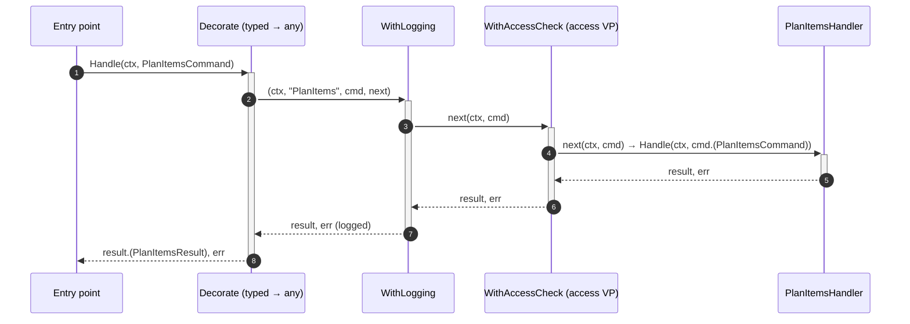

# Handler decorator

A **handler decorator** is one step done around every command call — log it, check the caller's access, open and commit a transaction — written once and wrapped around every handler. In Go it is a `pipeline.Decorator`; in the base plateau the only one is `pipeline.WithLogging(logger)`.

## Why it exists

Some steps belong to every command but to no command in particular. Written inside each handler they repeat in every file, and adding one (say, when the DB variation point arrives) means editing every handler.

A decorator writes the step once. The [composition root](./composition-root.md) lists the decorators once, and the [command registry](./command-registry.md) wraps every handler with that list — so a variation point adds its decorator as one element of the list, and no handler, and no other variation point, changes.

## How it works

A decorator is a plain function. It is called with the command's name, the command, and `next` — the rest of the chain — and decides what to do around the call:

```go
// Decorator is one cross-cutting step around every command handler.
type Decorator func(ctx context.Context, name string, cmd any, next Next) (any, error)

// the step that logs every command (internal/command/pipeline/logging.go, shortened)
func WithLogging(logger *slog.Logger) Decorator {
	return func(ctx context.Context, name string, cmd any, next Next) (any, error) {
		logger.LogAttrs(ctx, slog.LevelInfo, "command called", slog.String("command", name), logging.Payload(cmd))
		res, err := next(ctx, cmd) // the decorators inside this one, then the handler
		// ... "command handled" or "command failed"
		return res, err
	}
}
```

Why `any`, when handlers are typed `Handler[TCommand, TResult]`? Because a Go generic function cannot be put into a slice, and the decorators must stand in one list. `pipeline.Decorate` is the adapter between the two worlds: it builds the chain around one typed handler and asserts the command and the result back to their types, so the handler and the entry points stay typed.



A decorator that applies to some commands only asks the command for a mark — an interface the command has a method of — and passes every other command on unchanged; the three kinds are in [base-plateau-extension-in-go](library/architecture/go/base-plateau-extension-in-go.skill/base-plateau-extension-in-go.skill.md).

## How it is structured

| Part | Rule |
|---|---|
| Signature | `func With{Step}(what the step needs) pipeline.Decorator` |
| Body | calls `next(ctx, cmd)` at most once, with the same command; returns an error of a kind to reject the command |
| Order | the list's first decorator is the outermost: first on the way in, last on the way out |
| Where listed | `cmd/{app}/main.go`, section `// [handlers]`, the argument of `command.NewHandlers` |
| Where applied | `internal/command/handlers.go`, by `pipeline.Decorate` for every command |

## Example

```go
// cmd/todo/main.go
handlers := command.NewHandlers([]pipeline.Decorator{
	pipeline.WithLogging(logger),
})
```

This is the Go counterpart of a MediatR pipeline behavior in the dotnet catalog.

## Related concepts

- [Command registry](./command-registry.md)
- [Handler contract](./handler-contract.md)
- [HandlerFunc](./handler-func.md)
- [Composition root](./composition-root.md)

## Sources

- Decorator pattern: https://refactoring.guru/design-patterns/decorator
- [decorator.go](../templates/internal/command/pipeline/decorator.go), [logging.go](../templates/internal/command/pipeline/logging.go)
