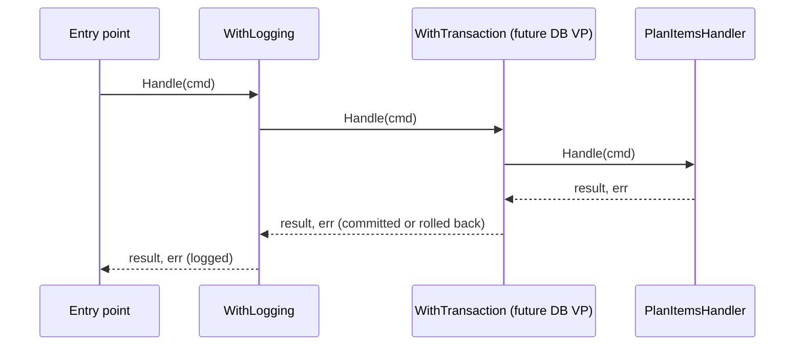

# Handler decorator

A **handler decorator** is a function that takes a handler and returns a new handler of the same type, which does something extra around the call — logs it, times it, opens and commits a transaction. In the base plateau it is `pipeline.WithLogging`.

## Why it exists

Some steps belong to every command but to no command in particular: logging, metrics, a database transaction. Written inside each handler they repeat in every file, and adding one (say, when the DB variation point arrives) means editing every handler.

A decorator writes the step once. The [composition root](./composition-root.md) wraps the handlers that need it — so a variation point adds a decorator with one line in the `// [handlers]` section, and no handler changes.

## How it works

The decorator receives the next handler, and returns a [HandlerFunc](./handler-func.md) that does its work before and after calling `next.Handle`:

```go
func WithLogging[TCommand, TResult any](name string, logger *slog.Logger, next Handler[TCommand, TResult]) Handler[TCommand, TResult] {
    return HandlerFunc[TCommand, TResult](func(ctx context.Context, cmd TCommand) (TResult, error) {
        start := time.Now()
        res, err := next.Handle(ctx, cmd)          // the wrapped handler does the real work
        // ... one log record: "command handled" or "command failed"
        return res, err
    })
}
```

Because input and output types are the same `Handler[TCommand, TResult]`, decorators stack: each one wraps the previous.



## How it is structured

| Part | Rule |
|---|---|
| Signature | `func With{Step}[TCommand, TResult any](..., next Handler[TCommand, TResult]) Handler[TCommand, TResult]` |
| Body | returns a `HandlerFunc` that calls `next.Handle` exactly once |
| Order | the decorator applied last runs first (outermost) |
| Where applied | `cmd/{app}/main.go`, section `// [handlers]` |

## Example

```go
// cmd/todo/main.go
var planItems pipeline.Handler[command.PlanItems, command.PlanItemsResult] = command.NewPlanItemsHandler()
planItems = pipeline.WithLogging("PlanItems", logger, planItems)
```

This is the Go counterpart of a MediatR pipeline behavior in the dotnet catalog.

## Related concepts

- [Handler contract](./handler-contract.md)
- [HandlerFunc](./handler-func.md)
- [Composition root](./composition-root.md)

## Sources

- Decorator pattern: https://refactoring.guru/design-patterns/decorator
- [logging.go](../templates/internal/command/pipeline/logging.go)
