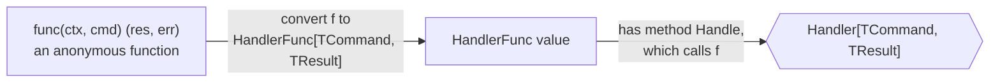

# HandlerFunc

`HandlerFunc[TCommand, TResult]` is a function type that **is** a handler: any function with the signature `func(ctx, cmd TCommand) (TResult, error)` converted to `HandlerFunc` satisfies the [handler contract](./handler-contract.md). It is the same trick as `http.HandlerFunc` in Go's standard library.

## Why it exists

A handler with dependencies — a planner, later a repository — is a struct with a `Handle` method (`PlanItemsHandler`). That is the normal case, and `HandlerFunc` is **not** used there.

But some handlers are built on the fly and have nothing to hold in a struct:

- a [decorator](./handler-decorator.md) returns a new handler that calls the wrapped one — writing a named struct type for each decorator would be boilerplate;
- a test needs a stub handler that just fails with `"boom"`.

`HandlerFunc` lets such a handler be written as one anonymous function.

## How it works

In Go a method can be declared on a function type. `HandlerFunc` declares `Handle`, and `Handle` simply calls the function itself:

```go
type HandlerFunc[TCommand, TResult any] func(ctx context.Context, cmd TCommand) (TResult, error)

func (f HandlerFunc[TCommand, TResult]) Handle(ctx context.Context, cmd TCommand) (TResult, error) {
    return f(ctx, cmd) // f is the function; calling Handle calls it
}
```

So the conversion `HandlerFunc[string, string](myFunc)` produces a value that has a `Handle` method — therefore it satisfies `Handler[string, string]`.



## How it is structured

| | Struct handler | HandlerFunc |
|---|---|---|
| Use when | the handler has dependencies or state | the handler is a closure built in place |
| Example | `PlanItemsHandler{planner}` | the handler `WithLogging` returns; a test stub |
| Satisfies `Handler` by | its own `Handle` method | the `Handle` method declared on `HandlerFunc` |

## Example

```go
// internal/api/startup/test/startup_steps_test.go - a stub handler in one line
failing := command.HandlerFunc[string, string](func(context.Context, string) (string, error) {
    return "", errors.New(message)
})
```

## Related concepts

- [Handler contract](./handler-contract.md)
- [Handler decorator](./handler-decorator.md) — the main user of `HandlerFunc`.

## Sources

- `net/http.HandlerFunc`, the standard-library original of this pattern: https://pkg.go.dev/net/http#HandlerFunc
- Go specification, method declarations: https://go.dev/ref/spec#Method_declarations
