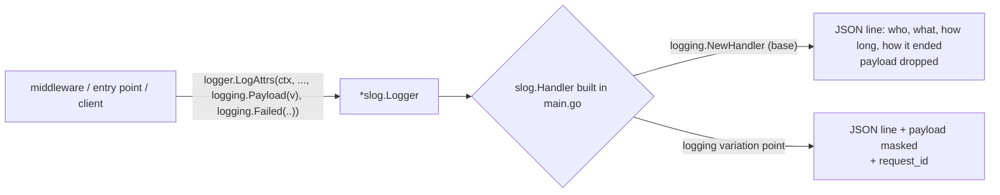

# Logging

**Logging** in the base plateau is one logger, built in `main.go`, that every part writes its records through with the same keys. What a record shows is decided by one `slog.Handler`, never by the part that writes it — so attaching the logging variation point changes the output, not the code.

## Why it exists

Three kinds of part log: the command logging middleware (a command was called, handled, failed), each entry point (an HTTP request, a gRPC call, a CLI run arrived), and later each client (a call went out). If each formatted its own data, no one place could mask a password in all of them, and the records of one request could not be tied together.

## Who writes what

Every layer writes a pair of records — one when the call comes in, one when it goes out — so the log of one request reads top-down as it was served:

```
http request received   POST /v1/items/plan         payload: query, headers, body
  command called        PlanItems                   payload: the command
    (client send / client response - with the client variation points)
  command handled       PlanItems, duration         payload: the result
http response sent      200, duration               payload: the response body as written
```

| Part | In | Out | Payload in / out |
|---|---|---|---|
| `commandlogging.Middleware` | `command called` | `command handled` / `command failed` (WARN) | the command / the result; a failure repeats the command |
| HTTP entry point | `http request received` | `http response sent` (`status`, `duration`, `failed`) | query, headers, body / the response body as written |
| gRPC entry point | `grpc call received` | `grpc call answered` (`code`, `duration`, `failed`) | the request message / the response message |
| CLI entry point | `cli call received` (once parsed) | `cli call answered` (`duration`, `failed`) | the flags given / the output as printed |

The out record of a **failure** repeats the input, so it is in the log even when the logging variation point keeps the payload of failed records only (`LOG_PAYLOAD=errors`). The response is logged as it was sent, not as the command returned it, so a fault in turning a result into the response shows in the log. Every entry point also puts a **request id** into the context (`logging.WithRequestID`): the client's (`X-Request-Id`, `x-request-id`) or a new one, sent back in the response.

## How it works



The base handler drops the payload so that no data — and no secret in it — is ever written by a service that did not attach the logging variation point, which writes the payload only after masking it.

## How it is structured

| Part | Role |
|---|---|
| `logging.NewHandler(w, level)` | the base handler: JSON lines, payload dropped |
| `logging.Payload(v)`, `logging.PayloadKey` | the one attribute the data of a call goes in |
| `logging.Failed(bool)`, `logging.FailedKey` | whether the call ended with an error |
| `logging.WithRequestID`, `RequestID`, `NewRequestID` | the request id in the context |

## Example

```json
{"level":"INFO","msg":"http request received","method":"POST","path":"/v1/items/plan"}
{"level":"INFO","msg":"command called","command":"PlanItems"}
{"level":"INFO","msg":"command handled","command":"PlanItems","duration":1253,"failed":false}
{"level":"INFO","msg":"http response sent","method":"POST","path":"/v1/items/plan","status":200,"duration":2101,"failed":false}
```

## Related concepts

- [Command middleware](./command-middleware.md) — `commandlogging.Middleware` writes the command's records.
- [Composition root](./composition-root.md) — builds the one logger.

## Sources

- `log/slog`, handlers and `ReplaceAttr`: https://pkg.go.dev/log/slog
