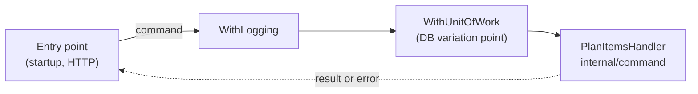

# Pipeline

The **pipeline** (`internal/command/pipeline`) is the path every command takes from an entry point to its handler, and the package that holds that path's parts: the [handler contract](./handler-contract.md), [HandlerFunc](./handler-func.md), the [decorators](./handler-decorator.md), and the [error kind](./error-kind.md). It holds no command.

## Why it exists

Two kinds of code meet around a command. One is the commands themselves — `PlanItems` and its handler — which change with the business. The other is the machinery every command passes through — the contract, logging, later a unit of work — which is the same for all of them and rarely changes. Kept in one folder, the machinery hides among the commands and a reader cannot tell which file is a command. The pipeline package separates them: `internal/command` lists only commands.

## How it works

A call goes through the pipeline like water through a pipe with fittings: the entry point puts the command in, each decorator does its step around the call, and the handler at the end does the work.



The fittings are added in the composition root's `// [handlers]` section; the entry point and the handler never know which ones are there.

## How it is structured

| Part | In `pipeline` | Used by |
|---|---|---|
| `Handler[TCommand, TResult]` | the contract | every handler (implements), every entry point and decorator (calls) |
| `HandlerFunc` | a function as a handler | decorators, test stubs |
| `WithLogging`, later more `With...` — one file each (`logging.go`, ...) | decorators | the composition root |
| `ErrInvalid`, `ErrNotFound`, ..., `KindOf` | the error kinds | entry points, to choose their response |

## Example

```go
// cmd/todo/main.go
var planItems pipeline.Handler[command.PlanItems, command.PlanItemsResult] = command.NewPlanItemsHandler()
planItems = pipeline.WithLogging("PlanItems", logger, planItems)
```

In dotnet the same role is played by MediatR: `IRequestHandler<TRequest, TResponse>` is the contract and an `IPipelineBehavior` is a decorator — hence the name.

## Related concepts

- [Handler contract](./handler-contract.md)
- [Handler decorator](./handler-decorator.md)
- [Error kind](./error-kind.md)

## Sources

- [handler.go](../templates/internal/command/pipeline/handler.go), [logging.go](../templates/internal/command/pipeline/logging.go)
- MediatR pipeline behaviors: https://github.com/jbogard/MediatR/wiki/Behaviors
