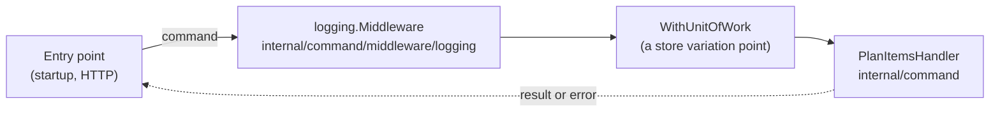

# Pipeline

The **pipeline** (`internal/command/pipeline`) is the path every command takes from an entry point to its handler, and the package that holds that path's parts: the [handler contract](./handler-contract.md), [HandlerFunc](./handler-func.md), the [command middleware](./command-middleware.md) with the adapter `Decorate`, and the [error kind](./error-kind.md). It holds no command.

## Why it exists

Two kinds of code meet around a command. One is the commands themselves — `PlanItemsCommand` and its handler — which change with the business. The other is the machinery every command passes through — the contract, logging, later a unit of work — which is the same for all of them and rarely changes. Kept in one folder, the machinery hides among the commands and a reader cannot tell which file is a command. The pipeline package separates them: `internal/command` lists only commands.

## How it works

A call goes through the pipeline like water through a pipe with fittings: the entry point puts the command in, each middleware does its step around the call, and the handler at the end does the work.



The fittings are listed in the composition root's `// [handlers]` section and fitted to every handler by the [command registry](./command-registry.md); the entry point and the handler never know which ones are there.

## How it is structured

| Part | In `pipeline` | Used by |
|---|---|---|
| `Handler[TCommand, TResult]` | the contract | every handler (implements), every entry point and middleware (calls) |
| `HandlerFunc` | a function as a handler | middleware, test stubs |
| `Middleware`, `Next`, `Decorate` (`middleware.go`) | a step around every command, and the adapter that wraps a typed handler with a list of them | middleware (`Middleware`), the command registry (`Decorate`) |
| `Middleware` of `internal/command/middleware/{name}` — not in `pipeline` | each middleware, one package each: `logging` in the base plateau, a variation point's beside it | the composition root |
| `ErrInvalid`, `ErrNotFound`, ..., `KindOf` | the error kinds | entry points, to choose their response |

## Example

```go
// internal/command/handlers.go - every handler wrapped by the list main.go gives
PlanItems: pipeline.Decorate("PlanItems", NewPlanItemsHandler(), middlewares),

// cmd/todo/main.go
handlers := command.NewHandlers([]pipeline.Middleware{commandlogging.Middleware(logger)})
```

In dotnet the same role is played by MediatR: `IRequestHandler<TRequest, TResponse>` is the contract and an `IPipelineBehavior` is a command middleware — hence the name of this package.

## Related concepts

- [Handler contract](./handler-contract.md)
- [Command middleware](./command-middleware.md)
- [Error kind](./error-kind.md)

## Sources

- [handler.go](../templates/internal/command/pipeline/handler.go), [middleware.go](../templates/internal/command/pipeline/middleware.go), [logging.go](../templates/internal/command/middleware/logging/logging.go)
- MediatR pipeline behaviors: https://github.com/jbogard/MediatR/wiki/Behaviors
