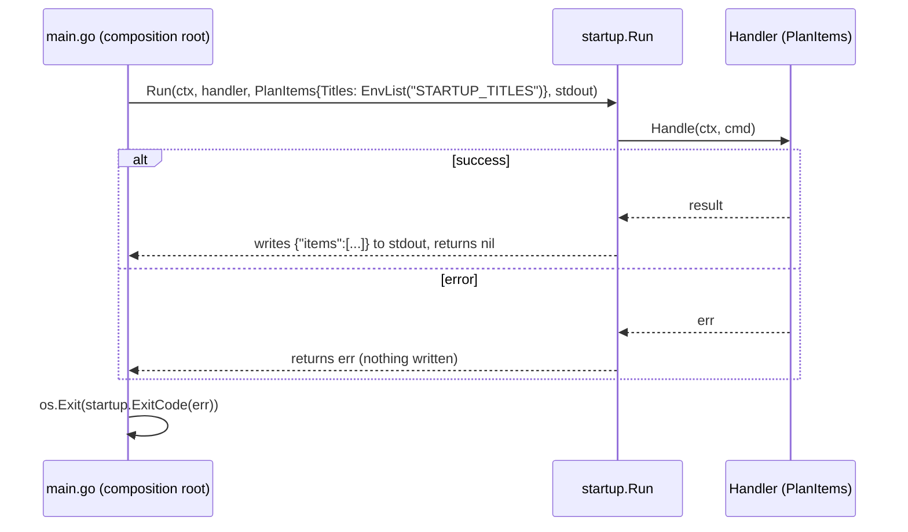

# Startup entry

The **startup entry** (`internal/api/startup`) is the base plateau's only way in: when the process starts, it runs one command, prints the result, and turns the outcome into the process exit code. It is the simplest entry point; API variation points (HTTP, gRPC, CLI, listener) are added beside it under `internal/api/`.

## Why it exists

A base plateau with no entry at all could not be run or tested end to end. One command at start is the smallest entry that makes the program useful — a job a script or a Kubernetes CronJob can run — without choosing a transport.

It is a package rather than lines in `main.go` because it has behaviour worth testing — the output format and the exit codes — and because every entry point lives in `internal/api/`, where it obeys the same rule: it imports only `internal/command`.

## What happens to it later

It exists only in the base plateau. When an API variation point is attached, its entry replaces the startup lines in `// [entries]` of `main.go`, and the `startup` package is deleted.

| Application | Startup entry |
|---|---|
| Only the base (a job run by a scheduler) | stays — it is the only way in |
| + HTTP or gRPC (a service) | replaced by starting the server; package deleted |
| + CLI | replaced by the CLI entry, which chooses among many commands by its arguments |
| A service that must run one command once at start | stays beside the server — rare |

## How it works



`ExitCode` maps the [error kind](./error-kind.md): `nil` → `0`, a kind other than unavailable → `2`, unavailable or no kind → `1`. Logs go to standard error, so standard output holds only the result.

## How it is structured

| Part | Role |
|---|---|
| `Run[TCommand, TResult]` | calls any handler once, encodes the result as one JSON line |
| `ExitCode(err)` | error kind → exit code |
| `ExitOK`, `ExitFailure`, `ExitRejected` | the three exit codes |
| `EnvList(name)` | reads the command's input from a comma-separated environment variable; the setting belongs to the entry, so it goes away with it |

## Example

```bash
$ STARTUP_TITLES="buy milk,walk the dog" ./bin/todo
{"items":[{"title":"buy milk","done":false},{"title":"walk the dog","done":false}]}
$ echo $?
0
```

## Related concepts

- [Composition root](./composition-root.md) — chooses the command and builds its input.
- [Error kind](./error-kind.md)
- [Handler contract](./handler-contract.md)

## Sources

- [startup.go](../templates/internal/api/startup/startup.go)
- [startup.feature](../examples/internal/api/startup/features/startup.feature)
