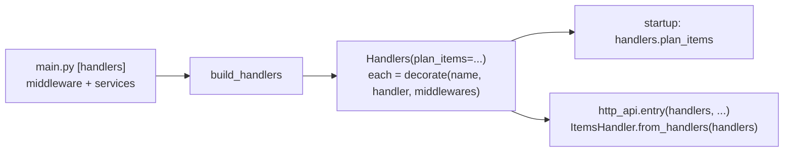

# Command registry

The **command registry** (`command/handlers.py`) is the one place that builds the handler of every command and wraps each with the middleware: the frozen dataclass `Handlers`, one field per command, filled by `build_handlers`.

## Why it exists

Without it the composition root built and wrapped each handler itself, one line per command and middleware. A middleware that every command needs — logging, an access check — then had to be added once per command, and a command added in a hurry could miss one. The registry turns "every handler" into one call: the composition root gives the list of middleware once, and a new command touches only the command layer.

## How it works

1. The composition root calls `build_handlers(middlewares, ...services)` once, in `# [handlers]`.
2. `build_handlers` builds each handler with the services it uses and wraps it with `decorate(name, handler, middlewares)` — the list's first middleware outermost.
3. Each field holds a typed `Handler[TCommand, TResult]` — already decorated, so an entry point cannot tell it from a plain one, and `mypy --strict` checks the command an entry point passes.
4. An entry point takes the handlers it serves: the startup entry `handlers.plan_items`, an API's resource its own commands in `{Resource}Handler.from_handlers(handlers)`.



## How it is structured

| Part | Rule |
|---|---|
| `Handlers` | a frozen dataclass, one typed field per command, named like the command's module (`plan_items`) |
| `build_handlers(middlewares, *, services...)` | the middleware first, then the services the handlers use as keyword parameters, each typed by a protocol of `command` |
| a new command | a field and a line here, its module in `command`; `main.py` does not change |
| a new service | a keyword parameter here, passed by `main.py` from `# [services]` |

## Example

```python
# command/handlers.py
@dataclass(frozen=True)
class Handlers:
    plan_items: Handler[PlanItemsCommand, PlanItemsResult]


def build_handlers(middlewares: Sequence[Middleware]) -> Handlers:
    return Handlers(
        plan_items=decorate("PlanItems", PlanItemsHandler(), middlewares),
    )
```

## Related concepts

- [Handler contract](./handler-contract.md)
- [Entry runner](./entry-runner.md)

## Sources

- [handlers.py](../examples/src/todo/command/handlers.py), [middleware.py](../templates/src/{package}/command/pipeline/middleware.py)
