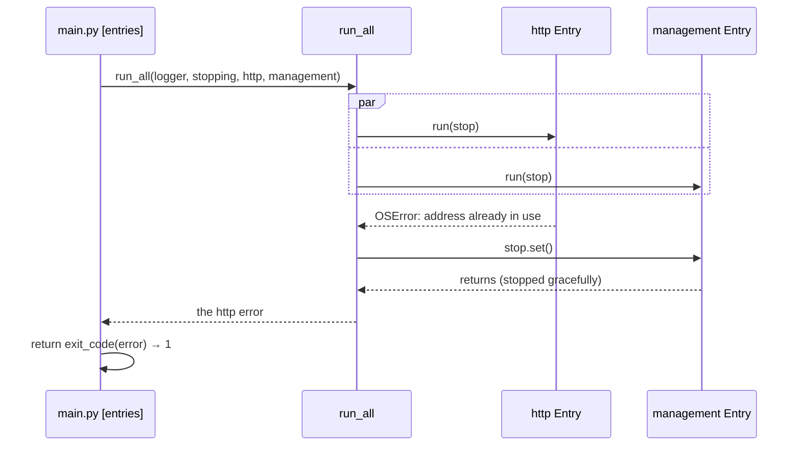

# Entry runner

The **entry runner** (`api/core/entry`) starts every entry point of the application together — the startup command, an HTTP server, a gRPC server, the health endpoints — and turns how they ended into the process exit code. It is why each variation point attaches with one line in `# [entries]`.

## Why it exists

An HTTP server serves until the process is told to stop. Awaited one after another, the second entry point would never start; started side by side by each variation point, every pair of variation points would become its own piece of code. Written once in the base, each variation point only adds an item to a list.

## How it works

1. `# [entries]` passes `run_all` one `Entry(name, run)` per entry point; `run` takes an `asyncio.Event` and serves until it is set.
2. `run_all` starts every `run` as an asyncio task, all given the same event.
3. When the **first** task ends — a one-shot command done, a server that failed — or `stopping` is set on SIGTERM, `run_all` sets the event, so the others stop gracefully, and waits for them.
4. It returns the first error any entry raised, or `None`, and logs each failure with the entry's name, unless the entry reports its own errors (the CLI).
5. `exit_code(error)` turns it into the exit code by the error kind.



| Situation | Result | Exit code |
|---|---|:-:|
| startup command done | the others are stopped | `0` |
| SIGTERM | every entry stops gracefully | `0` |
| a server cannot start (port taken) | the others are stopped | `1` |
| startup command rejected (a kind other than unavailable) | the others are stopped | `2` |

## Example

```python
# [entries] - a service with HTTP and health: each variation point brought one Entry.
ended_by = await run_all(
    logger,
    stopping,
    Entry("http", lambda stop: http_api.run(endpoints, logger, stop)),
    Entry("management", lambda stop: management.run(logger, stop)),
)
return exit_code(ended_by)
```

## Related concepts

- [Handler contract](./handler-contract.md) — what an entry point calls.

## Sources

- `asyncio.wait` with `FIRST_COMPLETED`: https://docs.python.org/3/library/asyncio-task.html#asyncio.wait
- `asyncio.Event`: https://docs.python.org/3/library/asyncio-sync.html#asyncio.Event
