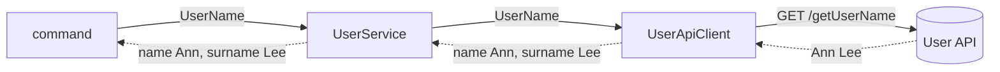
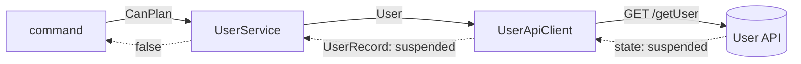
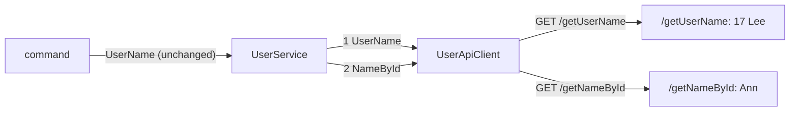

# API change cases

How the answer of an API becomes the application's values, and who changes when the API changes. The rules are [Return the application's values from the client](../api-client.skill.md#return-the-applications-values-from-the-client) and [Compose the client's operations in the service](../api-client.skill.md#compose-the-clients-operations-in-the-service); the reasoning is in [client-returns-application-values](../adr/client-returns-application-values.md).

| # | What turning the answer into the application's values needs | Who does it | What the client returns | Who changes when the API changes |
|---|---|---|---|---|
| 1 | only the answer | client | the application's values | the client |
| 2 | a decision of the application | service | a result type of its own | the client, and the service when its decision changes |
| 3 | several operations of the same API | service | a result type of its own per operation | the client and the service; the callers stay |
| 4 | data the API no longer holds: another system is now its master | outside api-client: the project | - | the project: a new client and service, a domain service or command joining them, their callers |

Solid arrows are calls, dashed arrows answers.

## 1. One answer is enough: the client maps it

`/getUserName` answers `Ann Lee`; the application wants name and surname. Splitting the string needs nothing but the answer, so the client does it, and the service passes the values on.

## 2. A decision of the application: the service decides

`/getUser` answers `state: suspended`. Whether a suspended user may plan is the application's rule, not the API's. The client returns its own result type with the state in the application's words; the service decides.

## 3. The API splits an operation: the service composes its client's operations

The provider changes `/getUserName` to answer `{nameId} Lee` and adds `/getNameById`. Both are operations of the same API, so the client gets one more method and the service calls both. `UserService.UserName` still returns name and surname: no caller changes.

## 4. The data moves to another system: outside api-client

The provider stops holding names; they now live in a Directory API. The master system of the name has changed: the application depends on one more system, with its own contract, `{API}` group, mock, and outage. That is not hidden in a client or a service:

- a service never calls another service, so `UserService` cannot fetch the name from `DirectoryService`;
- one service over two clients would join two systems inside one service and hide the new dependency.

The service is redesigned at the level of the project: a client and a service for the Directory API, a domain service or a command joining the two answers, and its callers changed to call it.

@import "./diagrams/master-system-change.mmd" {as="mermaid"}
